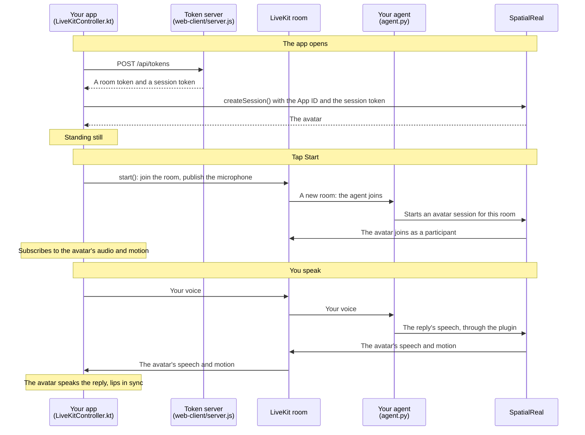

# LiveKit client (Android)

A Jetpack Compose app that joins your LiveKit room, sends the user's microphone to your agent, and renders the avatar that speaks the agent's replies. The app sends no speech of its own to SpatialReal — your agent does.

Docs: [LiveKit](https://docs.spatialreal.ai/avatar-integration/livekit/overview)

This is one client of the LiveKit example. Run the agent in [`../agent`](../agent) first, on the same LiveKit project, and the token server from [`../web-client`](../web-client).

## Before you start

- Android Studio
- An Android phone or tablet on Android 7.0 (API 24) or later, with a 64-bit ARM processor and Vulkan support, on the same network as your computer
- The agent from [`../agent`](../agent), running
- The token server from [`../web-client`](../web-client), running: `npm install && npm run server` there (it reads the API keys from that folder's `.env`)
- From [SpatialReal Studio](https://app.spatialreal.ai): your **App ID** ([Apps & API keys](https://docs.spatialreal.ai/studio/api-keys)) and the same **avatar ID** your agent uses

## Configure

Open this folder in Android Studio. Gradle fetches the SpatialReal SDK on its own: `ai.spatialreal:android-livekit` brings `ai.spatialreal:android` and `io.livekit:livekit-android` with it (`settings.gradle.kts` adds JitPack for LiveKit's audio routing library).

Fill in `app/src/main/java/ai/spatialreal/examples/livekitclient/Config.kt`:

| Value | What it is |
| --- | --- |
| `APP_ID` | Your App ID |
| `AVATAR_ID` | The avatar your agent uses |
| `TOKEN_SERVER_URL` | The token server: your computer's address on the network, for example `http://192.168.1.20:3000` |

## Run

Connect your device, choose it in Android Studio, and press **Run**. From a terminal:

```bash
./gradlew installDebug
```

## What you should see

1. The avatar appears, standing still: the app fetched its two tokens and downloaded the avatar.
2. Tap **Start** and allow the microphone. The app joins a new room; your agent joins it too and greets you — the avatar speaks it, lips in sync.
3. Speak. Your agent hears you, and the avatar speaks its reply.
4. **Mute** stops sending your microphone; **Leave** leaves the room and keeps the avatar on screen. **Start** joins again.

Every launch gets its own room, so two devices don't talk over each other.

## How it works



The app downloads the avatar from SpatialReal and opens no other connection to it. The avatar's speech and motion reach the app through the room, and the SDK plays them itself: don't play the avatar's audio track through `session.room` yourself, and leave the room with `end()` or `dispose()` rather than disconnecting `session.room`.

`RECORD_AUDIO` is requested when you tap **Start**; a `MicPolicy.REQUIRED` microphone that the user refuses makes `start()` fail with `mic-denied`. Both SDK artifacts use `protobuf-javalite`, like livekit-android: don't add the full `protobuf-java` to the app.
