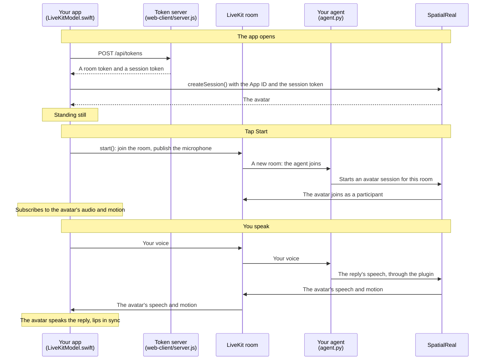

# LiveKit client (iOS)

A SwiftUI app that joins your LiveKit room, sends the user's microphone to your agent, and renders the avatar that speaks the agent's replies. The app sends no speech of its own to SpatialReal — your agent does.

Docs: [LiveKit](https://docs.spatialreal.ai/avatar-integration/livekit/overview)

This is one client of the LiveKit example. Run the agent in [`../agent`](../agent) first, on the same LiveKit project, and the token server from [`../web-client`](../web-client).

## Before you start

- Xcode 16 or later
- An iPhone or iPad on iOS 16 or later (A11 chip or newer). Use a device: on the simulator the room joins, but the avatar's voice may not play
- The agent from [`../agent`](../agent), running
- The token server from [`../web-client`](../web-client), running: `npm install && npm run server` there (it reads the API keys from that folder's `.env`)
- From [SpatialReal Studio](https://app.spatialreal.ai): your **App ID** ([Apps & API keys](https://docs.spatialreal.ai/studio/api-keys)) and the same **avatar ID** your agent uses

## Configure

Open `LiveKitClientExample.xcodeproj`. Xcode fetches the SpatialReal SDK on its own (the `SpatialRealSDK` and `SpatialRealLiveKit` products of `ios-sdk-release`).

Fill in `LiveKitClientExample/Config.swift`:

| Value | What it is |
| --- | --- |
| `appId` | Your App ID |
| `avatarId` | The avatar your agent uses |
| `tokenServerURL` | The token server. On a device, your computer's address on the network, for example `http://192.168.1.20:3000` |

Pick your team under **Signing & Capabilities**. The first time, iOS asks to allow the app on your local network, and then the microphone.

## Run

Choose your device, and press **Run** (⌘R).

## What you should see

1. The avatar appears, standing still: the app fetched its two tokens and downloaded the avatar.
2. Tap **Start** and allow the microphone. The app joins a new room; your agent joins it too and greets you — the avatar speaks it, lips in sync.
3. Speak. Your agent hears you, and the avatar speaks its reply.
4. **Mute** stops sending your microphone; **Leave** leaves the room and keeps the avatar on screen. **Start** fetches a new room and dispatches a fresh agent.

Every launch and every Start after Leave gets its own room, so two devices don't talk over each other and reconnecting starts a fresh agent.

## How it works

The app downloads the avatar from SpatialReal and opens no other connection to it. The avatar's speech and motion reach the app through the room, and the SDK plays them itself: don't play the avatar's audio track through `session.room` yourself, and leave the room with `end()` or `dispose()` rather than disconnecting `session.room`.

`NSMicrophoneUsageDescription` is set in the target's build settings. The app explicitly requests microphone access before Start and displays a Settings hint if access is denied. LiveKit manages microphone capture and the audio session using its default backend.

Test speech directly on the physical device with Device Hub screen sharing closed. [Device Hub can block microphone access and cause silent recordings](https://developer.apple.com/documentation/xcode/interacting-with-your-app-in-device-hub#Handle-camera-and-microphone-access-conflicts-on-physical-devices), even when permission is granted and the microphone track is published.
