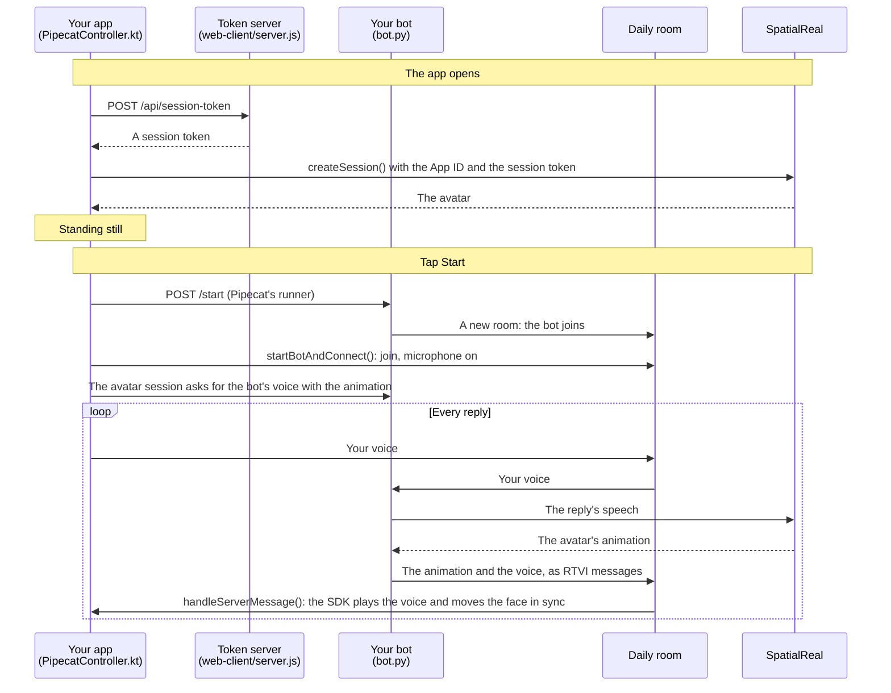

# Pipecat client (Android)

A Jetpack Compose app that joins your Pipecat bot's Daily room, sends the user's microphone to the bot, and renders the avatar that speaks the bot's replies. The app sends no speech to SpatialReal and opens no connection of its own to it: the bot's voice and the animation both arrive through the call.

Docs: [Pipecat Android client](https://docs.spatialreal.ai/avatar-integration/pipecat/android-client)

This is one client of the Pipecat example. Run the bot in [`../bot`](../bot) first, on Daily, and the token server from [`../web-client`](../web-client).

## Before you start

- Android Studio, or JDK 17 or later and the Android SDK
- A phone or emulator on Android 7.0 (API 24) or later, 64-bit ARM
- The bot from [`../bot`](../bot), running on Daily and reachable from the device: `uv run bot.py -t daily --host 0.0.0.0`. It needs `pipecat-spatialreal` 0.2.0 or later
- The token server from [`../web-client`](../web-client), running: `npm install && npm run server` there (it reads the API key from that folder's `.env`)
- From [SpatialReal Studio](https://app.spatialreal.ai): your **App ID** ([Apps & API keys](https://docs.spatialreal.ai/studio/api-keys)) and the same **avatar ID** your bot uses

## Configure

Fill in `app/src/main/java/ai/spatialreal/examples/pipecatclient/Config.kt`:

| Value | What it is |
| --- | --- |
| `APP_ID` | Your App ID |
| `AVATAR_ID` | The avatar your bot uses |
| `BOT_SERVER_URL` | Pipecat's development runner, at your computer's address on the network, for example `http://192.168.1.20:7860` |
| `TOKEN_SERVER_URL` | The token server, for example `http://192.168.1.20:3000` |

From the Android emulator, `10.0.2.2` reaches the computer it runs on: `http://10.0.2.2:7860` and `http://10.0.2.2:3000`.

The SDK comes from Maven Central as `ai.spatialreal:android-pipecat`, which brings `ai.spatialreal:android` and Pipecat's Daily transport with it.

## Run

Open this folder in Android Studio and run the `app` configuration, or:

```bash
./gradlew :app:installDebug
```

## What you should see

1. The avatar appears, standing still: the app fetched a session token and downloaded the avatar.
2. Tap **Start** and allow the microphone. The runner starts a bot in a new Daily room, the app joins it, and the bot greets you through the loudspeaker. From the first pause in its speech, the avatar speaks, lips in sync; the status line says where the bot's voice comes from.
3. Speak. The bot hears you, and the avatar speaks its reply. Talk over it, and it stops.
4. **Leave** ends the conversation and keeps the avatar on screen; **Start** begins a new one with a fresh bot.

## How it works



Daily's Android SDK doesn't let an app tap the bot's audio track, so the avatar session asks the bot's processor to send each reply's audio along with the animation, and plays it itself. Until the first pause in the bot's speech, Daily plays the bot's track as usual; then the session switches that track off and the avatar takes over. Leave the bot's audio track to the session: don't mute it, unsubscribe it or play it yourself.

Every conversation gets a new `PipecatClient` on the same `DailyTransport`, which the avatar session was created with. Leave ends the avatar session before disconnecting the client, while the call can still switch the bot's audio track back on. When the bot is ready, the app moves Daily's audio to the loudspeaker, as for a video call.

`usesCleartextTraffic` in the manifest allows plain `http://` to the bot and token server on your network. A production app talks to its server over `https://` and drops it.

## Something doesn't work?

- **The avatar stands still while the bot talks**: the status line stays on "voice from the call". The bot must run `pipecat-spatialreal` 0.2.0 or later, with the same avatar.
- **Start says it could not reach the bot**: the runner must be running with `-t daily --host 0.0.0.0`, and `BOT_SERVER_URL` must be reachable from the device.
- **The build stops with two files at `lib/*/libc++_shared.so`**: the SDK and Daily each ship one. Add `packaging { jniLibs { pickFirsts += "**/libc++_shared.so" } }` to the `android` block of `app/build.gradle.kts`.
