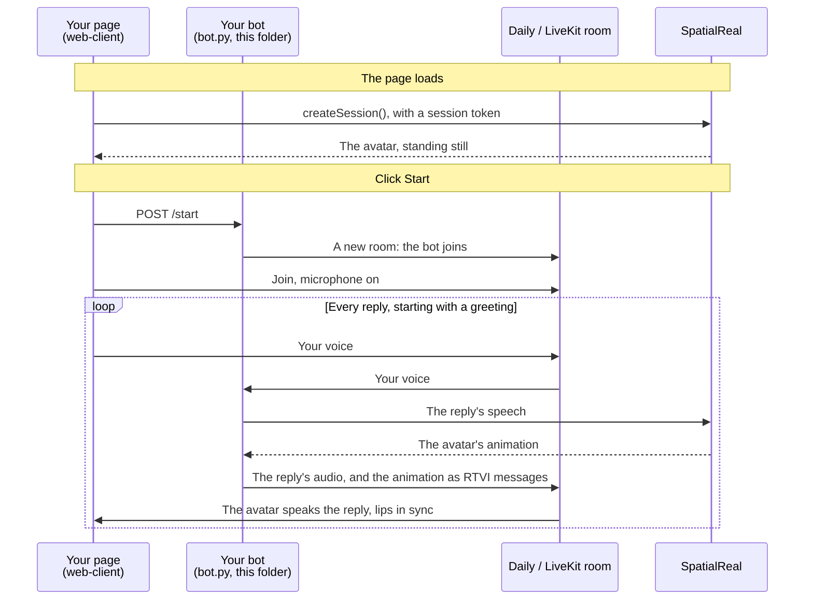

# Pipecat bot

A [Pipecat](https://github.com/pipecat-ai/pipecat) voice bot in Python with the SpatialReal processor: whatever the bot says, the avatar speaks in the browser, with lip-sync and expressions.

Docs: [Pipecat bot](https://docs.spatialreal.ai/avatar-integration/pipecat/bot)

This is one half of the Pipecat example. The other half is what users talk from: the page in [`../web-client`](../web-client), or the [iOS](../ios-client) or [Android](../android-client) app.

## Before you start

- Python 3.11 or later, and [uv](https://docs.astral.sh/uv/)
- A [Daily](https://www.daily.co) API key, or a [LiveKit](https://livekit.io) project: its URL, API key and API secret
- From [SpatialReal Studio](https://app.spatialreal.ai): your **App ID** and **API key** ([Apps & API keys](https://docs.spatialreal.ai/studio/api-keys)), and an **avatar ID** ([Avatar library](https://docs.spatialreal.ai/studio/public-avatar))
- API keys for the voice pipeline: [Deepgram](https://deepgram.com) (speech to text), [Google AI Studio](https://aistudio.google.com) (Gemini, the replies) and [Cartesia](https://cartesia.ai) (text to speech)

## Configure

```bash
cp .env.example .env
```

Fill in `.env`:

| Variable | What it is |
| --- | --- |
| `SPATIALREAL_API_KEY`, `SPATIALREAL_APP_ID` | Your SpatialReal API key and App ID |
| `SPATIALREAL_AVATAR_ID` | The avatar that speaks for the bot |
| `DEEPGRAM_API_KEY`, `GOOGLE_API_KEY`, `CARTESIA_API_KEY` | The voice pipeline |
| `DAILY_API_KEY` | Daily: the bot creates a room for every conversation |
| `LIVEKIT_URL`, `LIVEKIT_API_KEY`, `LIVEKIT_API_SECRET` | LiveKit, instead of Daily |

## Run

```bash
uv run bot.py -t daily
```

or `-t livekit`. Pipecat's development runner listens on http://localhost:7860 and starts a bot for every conversation the page asks for. Now start the [web client](../web-client) with the same avatar ID and transport, click **Start** and speak.

## What you should see

- When you click **Start** on the page, the runner creates a room and the bot joins it.
- The bot greets you. Then, whatever it says, the avatar speaks, lips in sync.

## How it works



The bot's audio plays through the room as usual. The SpatialReal processor sends the animation alongside it as RTVI server messages, and the web SDK in the page lines the two up.

## How it maps to the docs

| Docs step | Where it is in `bot.py` |
| --- | --- |
| Install | `pyproject.toml` |
| Add the processor after the TTS | `SpatialRealAvatarProcessor(...)` and the `Pipeline([...])` list |
| Keep RTVI on | `PipelineWorker(...)`: on by default |
| Run the bot | `uv run bot.py -t daily` |

The rest of `bot.py` is an ordinary Pipecat voice bot: swap in your own speech-to-text, model and text-to-speech, and the avatar keeps working.

## Something doesn't work?

- **The bot speaks but the avatar doesn't move**: read the bot's log for a SpatialReal error, and check the `SPATIALREAL_*` values. The page and the bot must use the same avatar.
- **The page says `/start` failed**: the bot must be running, with the transport the page uses (`-t daily` or `-t livekit`).
