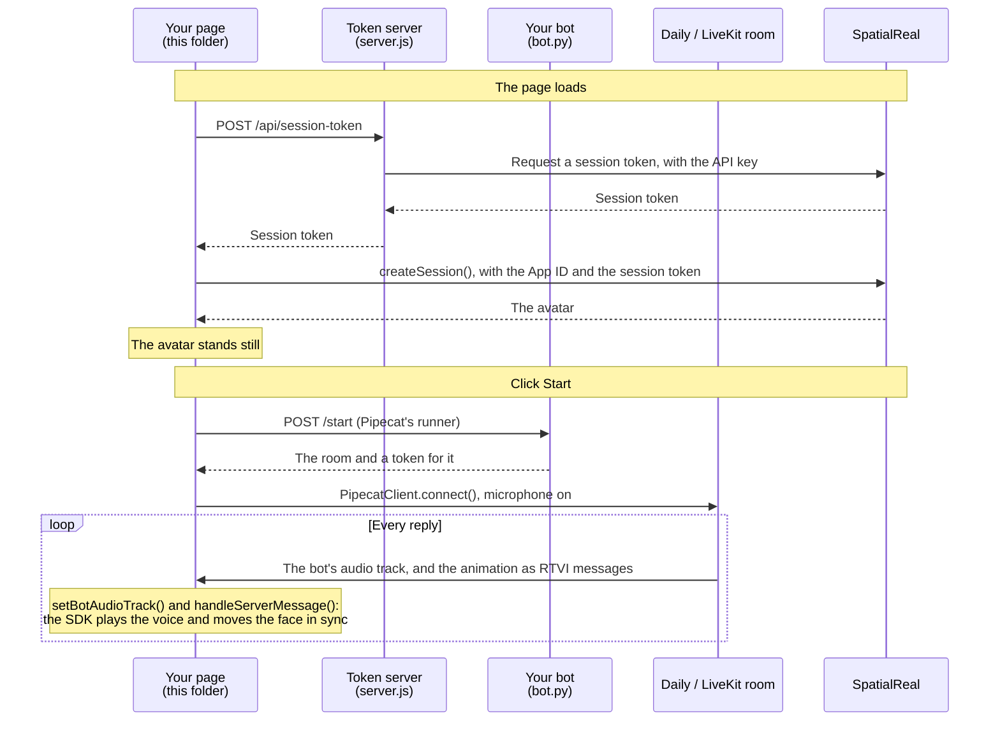

# Pipecat web client

A web page that joins your Pipecat bot's room, sends the user's microphone to the bot, and renders the avatar that speaks the bot's replies.

Docs: [Pipecat web client](https://docs.spatialreal.ai/avatar-integration/pipecat/web-client)

This is one half of the Pipecat example. Run the bot in [`../bot`](../bot) first.

## Before you start

- Node.js 20.19 or later
- The bot from [`../bot`](../bot), running
- From [SpatialReal Studio](https://app.spatialreal.ai): your **App ID** and **API key** ([Apps & API keys](https://docs.spatialreal.ai/studio/api-keys)), and the same **avatar ID** your bot uses
- A microphone

## Configure

```bash
cp .env.example .env
```

Fill in `.env`:

| Variable | What it is |
| --- | --- |
| `VITE_SPATIALREAL_APP_ID` | Your App ID |
| `VITE_SPATIALREAL_AVATAR_ID` | The avatar your bot uses |
| `VITE_PIPECAT_TRANSPORT` | `daily` or `livekit`: the transport your bot runs with |
| `SPATIALREAL_API_KEY` | Your SpatialReal API key. Only `server.js` reads it |

## Run

```bash
npm install
npm run dev
```

Open http://localhost:5173.

## What you should see

1. The avatar appears, standing still.
2. Click **Start** and allow the microphone. The bot joins a new room and greets you.
3. Speak. The bot hears you, and the avatar speaks its reply, lips in sync. Talk over it, and it stops.
4. **Leave** ends the conversation and keeps the avatar on screen; **Start** begins a new one.

## How it works



The page never plays the bot's audio track itself: it hands the track to the SDK, which plays it in sync with the face.

## How it maps to the docs

| Docs step | Where it is |
| --- | --- |
| Install | `package.json`, `vite.config.ts` |
| Hand out a session token from your server | `server.js` — `POST /api/session-token` |
| Create the session | `src/App.vue` — `onMounted` |
| Connect to the bot on a click | `src/App.vue` — `start()` |
| Hand the SDK the bot's track and messages | `src/App.vue` — `onTrackStarted`, `onServerMessage` |
| Clean up | `src/App.vue` — `leave()`, `release()` |

## Something doesn't work?

See [Common problems](https://docs.spatialreal.ai/avatar-integration/pipecat/web-client#common-problems). If the bot speaks but the avatar doesn't move, check the bot's terminal for a SpatialReal error, and that both halves use the same avatar.
