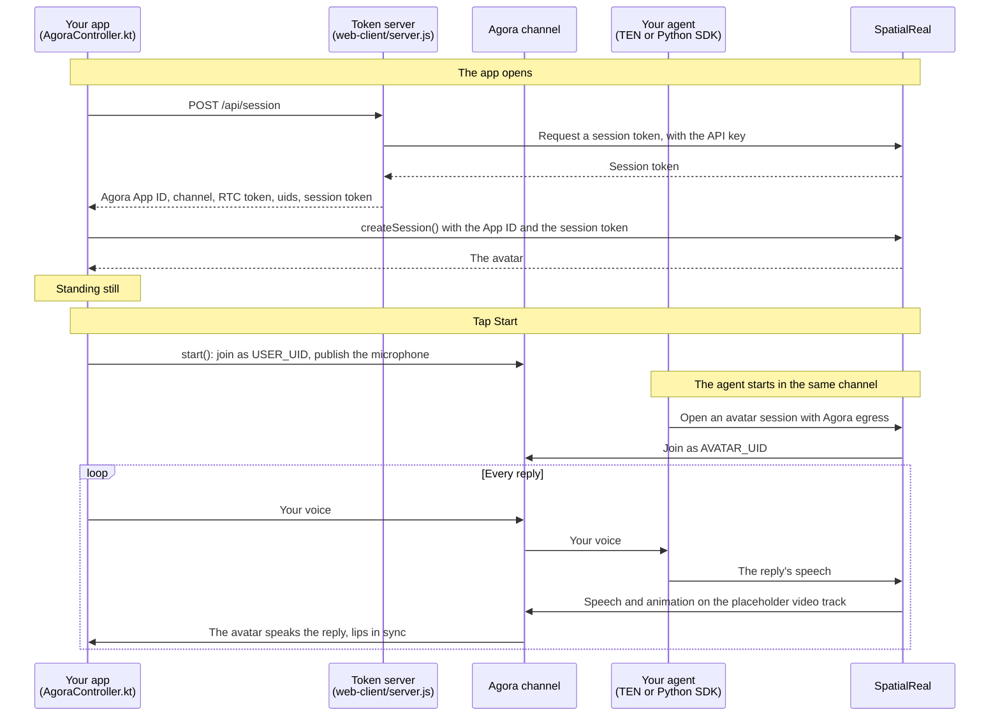

# TEN Framework client (Android)

A Jetpack Compose app that joins your Agora channel, sends the user's microphone to your agent, and renders the avatar that speaks the agent's replies. The app sends no speech of its own to SpatialReal — your agent does.

Docs: [TEN Framework](https://docs.spatialreal.ai/avatar-integration/ten-framework/overview)

This is one client of the TEN Framework example, the Android twin of [`../web-client`](../web-client). Start an agent that publishes a SpatialReal avatar into the channel ([`../agent`](../agent)), and the token server from [`../web-client`](../web-client).

## What the app shows

In an Agora channel, SpatialReal joins as its own uid (the **avatar uid**) and publishes the agent's speech, plus a placeholder video track whose frames carry the avatar's facial animation and its speech on one timeline. There are no rendered video frames: the avatar is rendered on the device. A plain Agora player shows the audio and a black picture; this app uses the SDK's Agora route (`ai.spatialreal:android-agora`), which joins the channel, reads that track and renders the avatar in sync with its voice.

## Before you start

- Android Studio
- An Android phone or tablet on Android 7.0 (API 24) or later, with a 64-bit ARM processor and Vulkan support, on the same network as your computer. A real device is recommended: this is a voice conversation, and it needs a working microphone and speaker
- Headphones (see [Notes](#notes))
- The agent from [`../agent`](../agent), running in the channel: the TEN voice agent, or the Python SDK snippet there
- The token server from [`../web-client`](../web-client), running: fill in that folder's `.env`, then `npm install && npm run server` there. It holds your SpatialReal API key and your Agora App Certificate, and hands the app everything it needs

## Configure

Open this folder in Android Studio. Gradle fetches the SpatialReal SDK on its own: `ai.spatialreal:android-agora` brings `ai.spatialreal:android` and Agora's `io.agora.rtc:full-rtc-basic` with it, all from Maven Central.

Fill in `app/src/main/java/ai/spatialreal/examples/tenclient/Config.kt`:

| Value | What it is |
| --- | --- |
| `TOKEN_SERVER_URL` | The token server: your computer's address on the network, for example `http://192.168.1.20:3000`. From the Android emulator, `http://10.0.2.2:3000` |

Everything else comes from the token server, so the values live in one place, [`../web-client/.env`](../web-client/.env.example): the SpatialReal App ID and avatar ID, the Agora App ID, the channel (`AGORA_CHANNEL`), the avatar's uid (`AVATAR_UID`) and this app's uid (`USER_UID`). They must match what your agent was started with: see [Pair it with an agent](../web-client#pair-it-with-an-agent).

## Run

Connect your device, choose it in Android Studio, and press **Run**. From a terminal:

```bash
./gradlew installDebug
```

## What you should see

1. The avatar appears, standing still: the app asked the token server for the channel and its two tokens, and downloaded the avatar.
2. Tap **Start** and allow the microphone. The app joins the channel.
3. Speak. Your agent hears you, and the avatar speaks its reply, lips in sync.
4. **Mute** stops sending your microphone; **End** leaves the channel and keeps the avatar on screen. **Start** joins again.

The order doesn't matter: the app renders the avatar from whenever both it and the agent are in the channel.

The app and the web client join with the same uid (`USER_UID`), and a channel holds one participant per uid: run one of them at a time.

## How it works



The app never talks to the agent directly: everything goes through the channel. The app downloads the avatar from SpatialReal and opens no other connection to it.

## How it maps to the code

| Step | Where it is |
| --- | --- |
| Install the Agora route of the SDK | `gradle/libs.versions.toml`, `app/build.gradle.kts` |
| Fetch the channel, an RTC token and a session token from your server | `AgoraController.kt` — `fetchSession()`; `../web-client/server.js` — `POST /api/session` |
| Create the session on the Agora route | `AgoraController.kt` — `create()`, `createSession(AgoraAvatarSessionOptions(… AgoraConnection.Join(…)))` |
| Ask for the microphone, then join the channel | `MainActivity.kt` — the **Start** button; `AgoraController.kt` — `start()` |
| Renew the RTC token | `AgoraController.kt` — `tokenRenewal`; `../web-client/server.js` — `POST /api/agora-token` |
| Mute, leave and clean up | `AgoraController.kt` — `toggleMute()`, `end()`, `release()` |

## Notes

- **Use headphones.** The SDK plays the avatar's voice on the device. On the loudspeaker the microphone can pick that voice up, the agent hears itself, and it may interrupt its own reply.
- **The SDK plays the avatar's voice itself and mutes Agora's copy.** The speech it plays is the one carried with the animation, so voice and lips share one timeline. `session.engine` is the underlying `RtcEngine`: don't unmute or play the avatar uid's audio through it, and leave the channel with `end()` or `dispose()` rather than `engine.leaveChannel()`.
- **Microphone permission.** The manifest declares `RECORD_AUDIO`, and the app requests it when you tap **Start**. With `MicPolicy.REQUIRED` (this app), a refused microphone makes `start()` fail with `mic-denied`; `MicPolicy.OPTIONAL` joins listen-only instead; `MicPolicy.MANUAL` publishes nothing until `setMicrophoneEnabled(true)`.
- **Plain `http://` to the token server.** Android blocks cleartext traffic by default. The manifest sets `android:usesCleartextTraffic="true"` so the app can reach the example token server on your own network. A production app talks to its server over `https://` and drops that attribute.
- **RTC token renewal.** The SDK never renews the Agora token. The app listens for `onTokenPrivilegeWillExpire` on `session.engine` and passes a fresh token from `POST /api/agora-token` to `engine.renewToken()`. The token given to `createSession()` is also the one every later **Start** joins with; it is valid for an hour, so after an hour outside the channel, reopen the app.
- **Your app already uses Agora?** An app holds one `RtcEngine`. Pass yours with `AgoraConnection.Shared(engine, avatarUid)` instead of `AgoraConnection.Join(…)`: the session then only reads the avatar from the channel you joined, and joining, the microphone and the engine stay yours.
- **uids are integers.** SpatialReal joins with a numeric uid, so every participant in the channel must use numeric uids.
- The SDK uses `protobuf-javalite`: don't add the full `protobuf-java` to the app.

## Something doesn't work?

- **`Token server: …` on launch**: the device can't reach `TOKEN_SERVER_URL`, or `../web-client/.env` is incomplete. Check that the device and your computer are on the same network; for a `502`, the server's terminal shows the reason.
- **The app joins but no avatar speaks**: the agent and the app must use the same Agora project and channel, and `AVATAR_UID` must equal the uid the agent publishes the avatar with. Check the agent's log for the avatar session error.
- **The agent never answers**: a TEN agent listens only to the `user_uid` it was started with; it must equal `USER_UID`.
- **`start()` fails with `connection-failed`**: the RTC token doesn't match the channel or uid, or it has expired.
- **Black video in another player**: that is a plain Agora player. Only the SpatialReal SDKs render the avatar.
- **`credential-invalid`**: `SPATIALREAL_APP_ID` doesn't belong to the API key that issued the session token.
