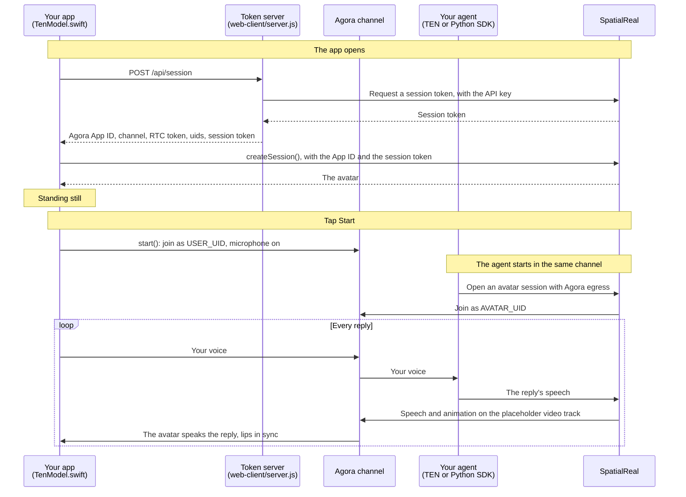

# TEN Framework client (iOS)

A SwiftUI app that joins your Agora channel, sends the user's microphone to your agent, and renders the avatar that speaks the agent's replies. The app sends no speech of its own to SpatialReal — your agent does.

Docs: [TEN Framework](https://docs.spatialreal.ai/avatar-integration/ten-framework/overview)

This is one client of the TEN Framework example. Start an agent that publishes a SpatialReal avatar into the channel first: the TEN voice agent in [`../agent`](../agent), or your own server with the Python SDK ([Without TEN](../agent#without-ten-python-sdk)). The app gets its tokens from the token server in [`../web-client`](../web-client), the same one the web page uses.

## What the app shows

In an Agora channel, SpatialReal joins as its own uid (the **avatar uid**) and publishes the agent's speech and a placeholder video track whose frames carry the avatar's speech and facial animation as metadata. There are no rendered video frames: the avatar is rendered on the device. A plain Agora player shows the audio and a black picture; this app uses the SDK's `SpatialRealAgora` product, which joins the channel, reads the metadata and renders the avatar in sync with its voice.

## Before you start

- Xcode 16 or later
- An iPhone or iPad on iOS 16 or later (A11 chip or newer). Use a device: the simulator is fine for checking that the app builds and joins, but not for judging the voice
- Headphones. The avatar's voice comes out of the device, so on the loudspeaker the microphone can pick it up and the agent may hear itself and interrupt its own reply
- An agent publishing the avatar into the channel: [`../agent`](../agent), or the Python SDK
- The token server from [`../web-client`](../web-client), running: fill in its `.env` ([Configure](../web-client#configure)), then `npm install && npm run server` there. It listens on port 3000

Everything the app needs comes from that server's `.env`: your Agora App ID, channel and uids, and your SpatialReal App ID and avatar ID. The SpatialReal API key and the Agora App Certificate stay on the server.

## Configure

Open `TenClientExample.xcodeproj`. Xcode fetches the SpatialReal SDK on its own (the `SpatialRealSDK` and `SpatialRealAgora` products of `ios-sdk-release`, 1.0.0-beta.7 or later), and the Agora SDK with it.

Fill in `TenClientExample/Config.swift`:

| Value | What it is |
| --- | --- |
| `tokenServerURL` | The token server. On a device, your computer's address on the network, for example `http://192.168.1.20:3000` |

Pick your team under **Signing & Capabilities**. The first time, iOS asks to allow the app on your local network, and then the microphone.

## Run

Choose your device, and press **Run** (⌘R).

## What you should see

1. The avatar appears, standing still: the app asked the token server what to join and downloaded the avatar.
2. Tap **Start** and allow the microphone. The app joins the channel.
3. Speak. Your agent hears you, and the avatar speaks its reply, lips in sync.
4. **Mute** stops sending your microphone; **End** leaves the channel and keeps the avatar on screen. **Start** joins again.

## Pair it with an agent

The app and the agent meet in one channel. Whatever publishes the avatar must use the same Agora project, `AGORA_CHANNEL` and `AVATAR_UID` as the token server's `.env`, and the same SpatialReal avatar.

- **TEN voice agent**: follow [`../agent`](../agent). Start the agent with `channel_name` set to your `AGORA_CHANNEL` and `user_uid` set to your `USER_UID`, then tap **Start** here.
- **Python SDK**: see [Without TEN](../agent#without-ten-python-sdk).

The order doesn't matter: the app renders the avatar from whenever both are in the channel.

The token server gives the web page and this app the same uid (`USER_UID`), and Agora allows a uid in a channel once. Run one of them at a time.

## How it works

The app never talks to the agent directly: everything goes through the channel.

## How it maps to the code

| Step | Where it is |
| --- | --- |
| Add the `SpatialRealSDK` and `SpatialRealAgora` products | `TenClientExample.xcodeproj` — Package Dependencies |
| Ask your server what to join | `TenModel.swift` — `post("api/session")`; `../web-client/server.js` — `POST /api/session` |
| Create the session on the Agora route | `TenModel.swift` — `create()`, `createSession(AgoraAvatarSessionOptions(… agora: .join(…)))` |
| Join the channel on a tap | `TenModel.swift` — `start()` |
| Renew the RTC token | `TenModel.swift` — `renewTokenBeforeExpiry()`; `../web-client/server.js` — `POST /api/agora-token` |
| Mute, leave and clean up | `TenModel.swift` — `toggleMute()`, `end()`, `release()` |

## Notes

- **The SDK plays the avatar's voice itself.** It decodes the speech carried with the animation and plays both on one clock, and it mutes Agora's own copy of the avatar's audio. Don't unmute the avatar uid on `session.engine` or play it a second time.
- **Use headphones, or expect echo.** Because the SDK plays the voice, on the loudspeaker the microphone can pick it up, and the agent may take it for the user speaking and interrupt itself.
- **Microphone.** `NSMicrophoneUsageDescription` is required; it is set in the target's build settings. With `mic: .required`, `start()` asks for the microphone and fails with `mic-denied` when the user refuses; the app then shows a Settings hint. `.optional` joins listen-only instead; `.manual` leaves the microphone to you.
- **Local token server.** The example token server speaks plain `http://` on your own network, so `Info.plist` sets `NSAllowsLocalNetworking`, and the build settings set `NSLocalNetworkUsageDescription`. A production app uses `https://` and needs neither.
- **Token renewal.** The SDK doesn't renew the Agora token. The server's tokens last an hour; the app fetches a fresh one every 45 minutes while it is in the channel and passes it to `session.engine.renewToken()`. If you change `TOKEN_TTL_S` in `server.js`, change the interval in `renewTokenBeforeExpiry()` with it. The token from `POST /api/session` is also the one **Start** joins with: after an hour on the first screen, relaunch the app.
- **The SDK owns the engine it creates.** With `.join`, the SDK creates the `AgoraRtcEngineKit`, joins as a broadcaster and is the engine's delegate. Use `session.engine` for your own calls, but don't replace its delegate or its encoded video frame delegate, and leave the channel with `end()` or `dispose()`. An app that already has an engine in the channel passes it with `agora: .shared(engine:avatarUid:)` instead.
- **Interruptions come from the agent.** When the user talks over a reply, the TEN agent stops it and the avatar stops with it; the app does nothing. `session.interrupt()` exists for stopping playback from the app's side.
- Test speech directly on the physical device with Device Hub screen sharing closed. [Device Hub can block microphone access and cause silent recordings](https://developer.apple.com/documentation/xcode/interacting-with-your-app-in-device-hub#Handle-camera-and-microphone-access-conflicts-on-physical-devices), even when permission is granted and the microphone track is published.

## Something doesn't work?

- **"Token server replied …" or a network error on launch**: the server isn't running, its `.env` is incomplete (it answers 502 when the SpatialReal API key is refused), or `tokenServerURL` isn't reachable from the device. On a device, `localhost` is the device itself.
- **The app joins but no avatar speaks**: the agent and the token server must use the same Agora project and channel, and `AVATAR_UID` must equal the uid the agent publishes the avatar with. Check the agent's log for the avatar session error.
- **The agent never answers**: a TEN agent listens only to the `user_uid` it was started with; it must equal `USER_UID`. Check that the web page isn't in the channel with the same uid.
- **`start()` fails with `connection-failed`**: the token doesn't match the channel or uid, or the channel couldn't be joined within 15 seconds.
- **The avatar interrupts itself**: the microphone hears the loudspeaker. Use headphones.
- **`credential-invalid`**: `SPATIALREAL_APP_ID` doesn't belong to the API key that issued the session token.
