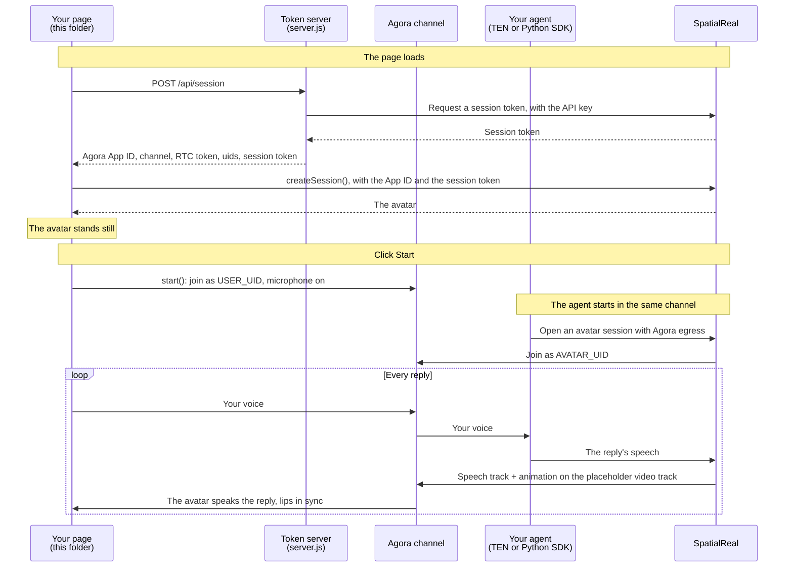

# TEN Framework web client

A web page that joins your Agora channel, sends the user's microphone to your agent, and renders the avatar that speaks the agent's replies.

Docs: [TEN Framework web client](https://docs.spatialreal.ai/avatar-integration/ten-framework/web-client)

This is one half of the TEN Framework example. Start an agent that publishes a SpatialReal avatar into the same channel: the TEN voice agent in [`../agent`](../agent), or your own server with the Python SDK ([Without TEN](../agent#without-ten-python-sdk)).

## What the page shows

In an Agora channel, SpatialReal joins as its own uid (the **avatar uid**) and publishes two tracks: the agent's speech, and a placeholder video track whose frames carry the avatar's facial animation as metadata. There are no rendered video frames: the avatar is rendered in the browser. A plain Agora player shows the audio and a black picture; this page uses `@spatialreal/web-sdk` in Agora mode, which joins the channel, reads the animation and renders the avatar in sync with its voice.

## Before you start

- Node.js 20.19 or later
- An agent publishing the avatar into the channel: [`../agent`](../agent), or the Python SDK
- An [Agora](https://console.agora.io) project: its App ID and App Certificate, the same project your agent uses
- From [SpatialReal Studio](https://app.spatialreal.ai): your **App ID** and **API key** ([Apps & API keys](https://docs.spatialreal.ai/studio/api-keys)), and the same **avatar ID** your agent uses
- A microphone

## Configure

```bash
cp .env.example .env
```

Fill in `.env`. Only `server.js` reads it; the page gets what it needs from `POST /api/session`.

| Variable | What it is |
| --- | --- |
| `SPATIALREAL_API_KEY` | Your SpatialReal API key. Never sent to the page |
| `SPATIALREAL_APP_ID` | Your SpatialReal App ID |
| `SPATIALREAL_AVATAR_ID` | The avatar your agent uses |
| `AGORA_APP_ID` | Your Agora App ID |
| `AGORA_APP_CERTIFICATE` | Your Agora App Certificate. Never sent to the page. Empty only for a project without a certificate |
| `AGORA_CHANNEL` | The channel your agent publishes the avatar into (default `spatialreal-demo`) |
| `AVATAR_UID` | The uid SpatialReal publishes the avatar with (default `1001`). It must match your agent's avatar uid |
| `USER_UID` | This page's uid (default `2001`). Your agent listens to this uid's microphone |

All uids are integers: SpatialReal's egress joins with a numeric uid, so every participant in the channel must use numeric uids.

## Run

```bash
npm install
npm run dev
```

Open http://localhost:5173.

## What you should see

1. The avatar appears, standing still.
2. Click **Start** and allow the microphone. The page joins the channel.
3. Speak. Your agent hears you, and the avatar speaks its reply, lips in sync.
4. **Mute** stops sending your microphone; **End** leaves the channel and keeps the avatar on screen.

## Pair it with an agent

The page and the agent meet in one channel. Whatever publishes the avatar must use the same Agora project, `AGORA_CHANNEL` and `AVATAR_UID`, and the same SpatialReal avatar.

- **TEN voice agent**: follow [`../agent`](../agent). Start the agent with `channel_name` set to your `AGORA_CHANNEL` and `user_uid` set to your `USER_UID`, then click **Start** here.
- **Python SDK**: create a session with `AgoraEgressConfig(channel_name=AGORA_CHANNEL, token=…, uid=AVATAR_UID)` and send it your speech; see [Without TEN](../agent#without-ten-python-sdk). The snippet there needs no microphone: it plays an audio file into the channel.

The order doesn't matter: the page renders the avatar from whenever both are in the channel.

## How it works



The page never talks to the agent directly: everything goes through the channel. The SDK plays the avatar uid's audio itself; don't subscribe to it and play it a second time.

## How it maps to the code

| Step | Where it is |
| --- | --- |
| Install, with `agora-rtc-sdk-ng` next to the SDK | `package.json`, `vite.config.ts` |
| Hand out an RTC token and a session token from your server | `server.js` — `POST /api/session` |
| Create the session in Agora mode | `src/App.vue` — `onMounted`, `createSession({ agora: { … } })` |
| Join the channel on a click | `src/App.vue` — `start()` |
| Renew the RTC token | `src/App.vue` — `renewTokenBeforeExpiry()`, `server.js` — `POST /api/agora-token` |
| Recover and clean up | `src/App.vue` — the `stalled` listener, `toggleMute()`, `end()`, `release()` |

The microphone follows the SDK's `mic` option: `'required'` (this page) fails `start()` with `mic-denied` when the user refuses; `'optional'` joins listen-only instead; `'manual'` waits for `session.mic.enable()`.

## Something doesn't work?

- **Black video, or audio with no avatar, in another player**: only `@spatialreal/web-sdk` in Agora mode renders the avatar. A plain Agora player (or the Agora web demo) shows the audio and a black picture; that is expected.
- **The page joins but no avatar speaks**: the agent and the page must use the same Agora project and channel, and `AVATAR_UID` must equal the uid the agent publishes the avatar with. Check the agent's log for the avatar session error.
- **The agent never answers**: a TEN agent listens only to the `user_uid` it was started with; it must equal `USER_UID`.
- **`start()` fails with `connection-failed`**: the token doesn't match the channel or uid, or the browser can't decode H.264.
- **A capability or profile error** (in the agent's log, or from the page before any speech plays): the agent's SDK, SpatialReal's backend and this page's SDK don't agree on the playback mode. Use `spatialreal` 0.4.0 or later on the agent side and `@spatialreal/web-sdk` 1.0.0-beta.7 or later here, or switch the agent to compatibility mode (`source_timeline_only: false`).
- **`connection-failed: Could not query the browser's codecs`** in your own Vite app, on the dev server only: `agora-rtc-sdk-ng` is CommonJS and must be pre-bundled. Add `optimizeDeps: { include: ['agora-rtc-sdk-ng'] }` to `vite.config.ts`, as this folder does.
- **`credential-invalid`**: `SPATIALREAL_APP_ID` doesn't belong to the API key that issued the session token.
